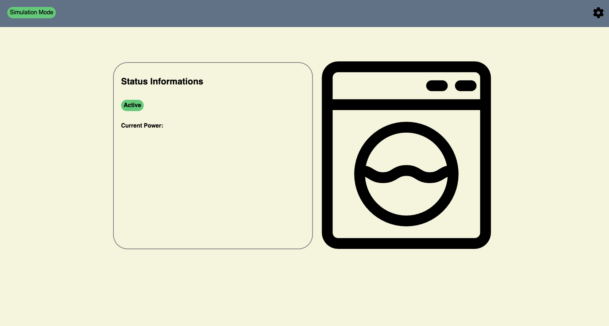

# Fritz_laundry_notify

This Project connects to your !FritzBox and reads the measured power of a selected Fritz! dect outlet. By analysing the measured power it checks if the washing machine is finished.

## Screenshots

Web dashboard (work in progress)


Startup of the main.py script


## Description

This project sends you a notification directly to your WhatsApp when your washing machine has finished washing. 
By checking the measured power at a smart outlet from FRITZ! it detects the start and also when the washing cycle is finished. Using CallMeBot you will receive a message so you do not miss to take out your laundry.

I also started on building a web dashboard for information and a simulation to test the script but it is not finished yet.

## Prerequisites

To run the script you need following things set up:

### Python Libraries
- fritzconnection
- dotenv
- requests
- flask

### Other services
- a CallMeBot bot set up in your WhatsApp (check the documentation here: https://www.callmebot.com/?ae_global_templates=setup-whatsapp)
- a FRITZ!box user (I would recommend to create a new user with limited rights)

### .env file
create an .env file in your project folder and insert your variables (check "Usage" to get the ain):

```ini
FRITZ_USERNAME=username
FRITZ_PASSWORD=password
FRITZ_BOX_IP=fritz_box_ip
DEVICE_AIN=ain
CALLMEBOT_APIKEY=apikey
PHONE_NUMBER=phone_number
```

## Installation & Starup

1. create a project folder and execute this command in this folder: git clone https://github.com/BelaKind/-Fritz_laundry_notify.git
2. On some systems it is necessary to install all libraries in a virtual environment (check it out here: https://docs.python.org/3/library/venv.html)
3. activate it by using 'project_folder/.venv/bin/activate'
4. install all libraries by using `pip3 install fritzconnection python-dotenv requests flask`
5. start the program with `python3 main.py`

## Usage

To use the script you have to run `print_devices` after the script started, search your specific outlet in the list and insert its AIN in the DEVICE_AIN variable in the .env file.
To test if the smart outlet is working correctly plug any device into the outlet and then type `print_power`. If it
seems to be the correct value it is working.

## Credits

### Libraries & APIs
* [fritzconnection](https://github.com) – communication with the FRITZ!box
* [CallMeBot](https://callmebot.com) – for sending messages to WhatsApp


### graphics & Icons (for the web dashboard)
* [Washing-machine-Icon](https://www.flaticon.com/free-icon/laundry_1075355) created by [Freepik - Flaticon](https://www.flaticon.com/) 
* Icons from [Font Awesome](https://fontawesome.com) - used in the Web UI